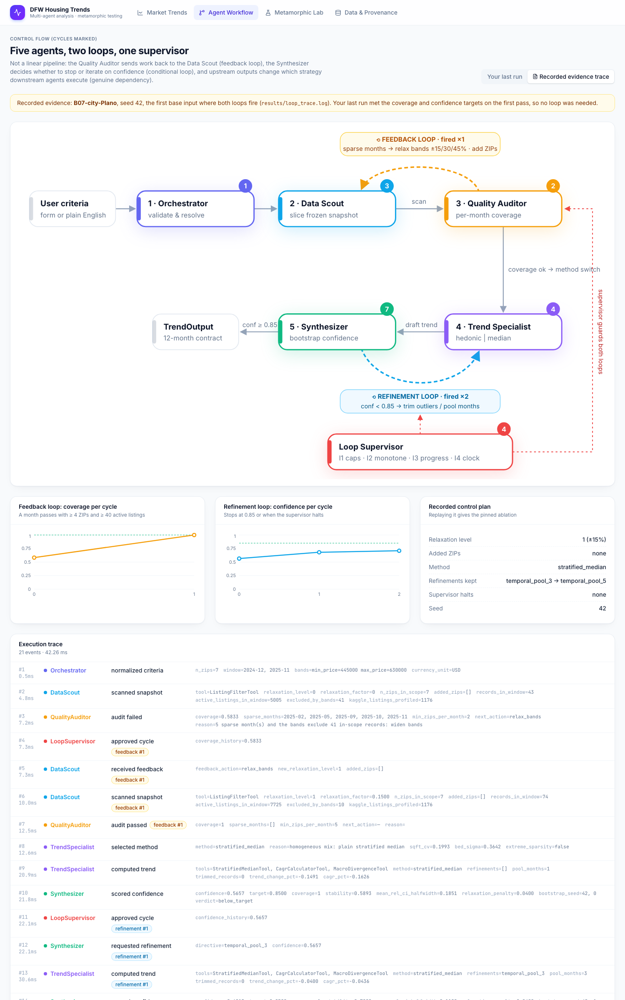
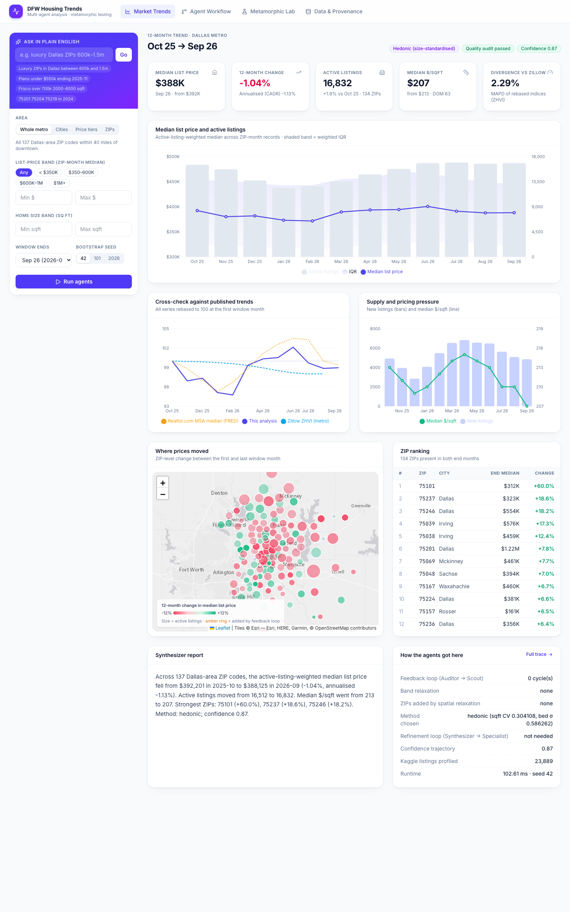
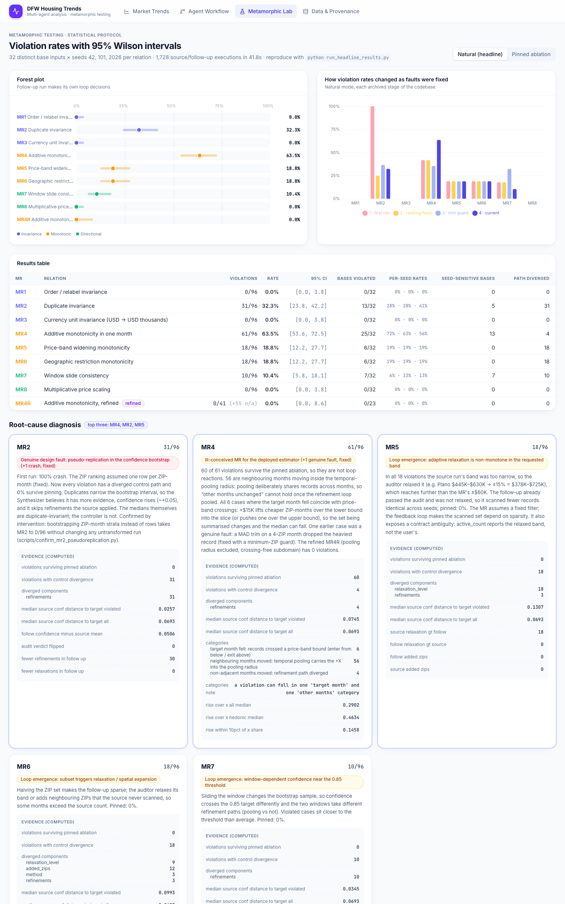

# Metamorphic Testing of a Multi-Agent Dallas Housing-Trends Application

**TSE assignment, final report.** Team: Vijay Arvaynthan S R (2023111007), Amjad Shaik (2025900012).
Repository: this folder. Headline numbers reproduce with `python run_headline_results.py` (about 40 s).

---

## Summary

We built a five-agent system plus a loop supervisor. It reports the 12-month movement of Dallas-area list prices from a frozen snapshot of **real** public data: Realtor.com ZIP-level monthly inventory, Kaggle/Realtor.com listings, Zillow ZHVI, FRED and FHFA. It has an interactive web UI. The control flow contains:

- a feedback loop (Quality Auditor → Data Scout),
- a confidence-driven refinement loop (Synthesizer → Trend Specialist),
- upstream signals that change which strategy downstream agents execute.

We defined eight metamorphic relations across the Invariance, Monotonic and Directional families. Each was tested on 32 distinct base inputs × 3 fixed seeds (96 executions per MR), with 95% Wilson intervals. We ran it in two modes:

- **natural:** the follow-up run makes its own loop decisions;
- **pinned:** the follow-up replays the source's control plan, as an ablation.

Headline (natural mode):

- MR1, MR3 and MR8 hold: 0/96 each, CI upper bound 3.8%.
- MR4 is violated most: 63.5%, CI [53.6, 72.5].
- MR2 at 32.3%, MR5 and MR6 at 18.8% each, MR7 at 10.4%.

The diagnosis separates three kinds of cause:

1. **MR4** is an ill-conceived relation for an estimator that pools neighbouring months, and the violations survive pinning (60/61). A refined MR4R holds: 0/41, CI [0, 8.6%]. Earlier, MR4 also exposed one **genuine fault**, an unstable outlier trim, which we fixed.
2. **MR2** exposed two problems.
   - A **genuine crash** (100% of runs), now fixed.
   - A **genuine design fault in the confidence model**. The bootstrap treats duplicated rows as independent evidence (pseudo-replication), so the controller skips refinements. Every remaining violation vanishes under pinning (0/96). A causal intervention, resampling ZIP-month strata instead of rows, takes MR2 from 31/96 to 0/96 without changing any untransformed run.
3. **MR5, MR6 and MR7** are **loop-emergent**. They are 0/96 when pinned. The adaptive relaxation and expansion, and the threshold-driven refinement, make the scanned set and estimator depend on sparsity. MR5 and MR6 as stated assume a fixed filter. The violations also expose a real contract ambiguity: does `active_count` mean "listings matching *your* criteria" or "listings the system decided to use"?

---

## 1. System

### 1.1 Architecture and control flow



*Figure 1. The control graph as rendered by the UI (Agent Workflow tab), replaying the recorded evidence run. Amber arc: feedback loop. Blue arc: refinement loop. Red dashed lines: supervisor guards. Badges count events per agent.*

| Agent | Responsibility | Tools |
|---|---|---|
| **Orchestrator** | Validates typed `SearchCriteria` (pydantic), resolves ZIPs, cities and price tiers to a ZIP set, builds the 12-month window | none |
| **Data Scout** | Slices the frozen snapshot with the current scan plan (relaxation level, added ZIPs); profiles composition from Kaggle listings | `ListingFilterTool`, `MacroLookupTool`, `CompositionProfileTool` |
| **Quality Auditor** | A month is adequate if it has ≥ 4 distinct ZIPs and ≥ 40 active listings; coverage = adequate months / 12. On failure returns a *typed action*: `relax_bands` if the bands exclude in-scope records and relaxation steps remain, otherwise `expand_spatial` | none |
| **Trend Specialist** | Chooses **hedonic** (price × (1800/sqft)^0.75) if CV(sqft) > 0.30 or σ(bedrooms) > 0.50, otherwise **stratified median**; stratified is forced under extreme sparsity (≤ 2 ZIPs in a month). Applies refinement directives | `HedonicRegressionTool`, `StratifiedMedianTool`, `CagrCalculatorTool`, `MacroDivergenceTool` |
| **Synthesizer** | Confidence = coverage × exp(−h/0.35) × (1 − 0.04·(relaxation level + expansion steps)), where h is the mean relative half-width of a seeded 200-resample bootstrap (90% interval) of each monthly weighted median; capped at 0.59 if the audit failed. Below 0.85 it requests the next refinement: `robust_trim` → `temporal_pool_3` → `temporal_pool_5`. It keeps the best-scoring draft | none |
| **Loop Supervisor** | I1 ≤ 3 cycles per loop; I2 coverage must not fall across feedback cycles; I3 each refinement must raise confidence; I4 run wall clock < 12 s | none |

**Agents and LLMs.** The agents are deterministic Python classes, and no LLM produces any number. An optional LLM at temperature 0 (Ollama, LM Studio or Gemini) only parses free-text questions into criteria in the UI. A rule-based parser does the same without one. The metamorphic harness never calls an LLM. We chose determinism deliberately: the only stochastic component is the seeded bootstrap. Seed variation is therefore controlled and attributable.

**Why the loops are necessary.** A ZIP set with a tight price band often leaves months with 1–3 ZIP-month records, and a median over two records is not a trend.

- *Feedback loop.* Only the auditor sees per-month adequacy, and only the scout can change the slice. So work has to flow back upstream. Over the 96 source runs (32 bases × 3 seeds):
  - The feedback loop fires in 51 runs (17/32 bases), with 69 band relaxations and 18 spatial expansions.
  - The supervisor halts it at the cycle cap in 12 runs.
- *Refinement loop.* Confidence is measured as bootstrap width. When it is low, the Synthesizer cannot fix it itself, because the estimator belongs to the Trend Specialist. 73 of 96 runs end with pooled estimates and 35 of 96 reach 0.85. I3 halts 7 runs that stopped improving. The rest deliver the best draft with caveats.
- *Genuine dependency.* The auditor's action chooses the scout's strategy (widen bands vs add ZIPs). The scout's composition signal chooses the estimator (36 hedonic and 60 stratified runs). The Synthesizer's directive changes how the next estimate is computed.

The median run takes 43 ms (maximum 114 ms).

### 1.2 Output contract

Every MR is stated against `TrendOutput` (`backend/schemas.py`):

- **`monthly_series[m]`**, for each of the 12 window months:
  - `active_count`: Σ active listings over in-scope ZIP-month records
  - `median_price`: active-listing-weighted *lower* median of the ZIP-month median list prices, hedonic-standardised if that method was chosen
  - `median_price_per_sqft`
  - `price_q1`, `price_q3`
  - `n_zips`, `new_listings`, `median_dom`
  - `mom_pct_price`
- **`trend_change_pct`**, **`annual_cagr_estimate`** = ((P_end/P_start)^(12/11) − 1)·100
- **`macro_divergence_score`**: MAPD of the rebased series against ZHVI
- **`zip_rankings`**
- **`confidence`**, **`quality_audit_passed`**, **`method`**

Counts always come from the full scan. Medians may come from the trimmed or pooled estimator. The run also returns its **`ControlPlan`**: relaxation level, added ZIPs, method, and the refinements kept. The harness uses it to tell estimator effects apart from control-path effects.

We chose the lower weighted median, not an interpolated one, so a median is always an observed record value. That makes the invariance relations exact rather than approximate.

### 1.3 User interface

React, Recharts and Leaflet, served by FastAPI (`python start.py`). Four tabs:

- **Market Trends:** criteria panel and natural-language box; KPIs; median price with IQR band and active listings; cross-check against FRED and ZHVI; ZIP map coloured by 12-month change, with ZIPs added by the loop ringed; ZIP ranking; narrative and caveats; agent decisions.
- **Agent Workflow:** the graph above, animated, with coverage and confidence per cycle and the full event timeline.
- **Metamorphic Lab:** forest plot with Wilson intervals, natural/pinned toggle, the fix history, diagnosis cards, the MR catalog, and a live single-case runner showing source vs follow-up.
- **Data & Provenance:** sources, hashes, macro series, and a Kaggle listing explorer.



*Figure 2. Market Trends tab for the whole metro, window ending 2026-09.*

## 2. Data source and frozen snapshot

All values are real and none are imputed. `data/snapshot/MANIFEST.json` records `all_values_real: true`, `synthetic_or_imputed_values: "none"`, the source URLs, the upstream hashes, the filters and each file's SHA-256. `run_headline_results.py` refuses to run if any hash differs.

| File | Source | Size | Role |
|---|---|---|---|
| `dfw_zip_month.csv` | Realtor.com Residential Listings Database, ZIP-level monthly history (`RDC_Inventory_Core_Metrics_Zip_History.csv`, 3,480,919 upstream rows) | 6,205 ZIP-months; 137 ZIPs × 46 months (2022-12 to 2026-09); 97 ZIP-months absent upstream and left absent | What the agents scan |
| `dfw_listings_kaggle.csv` | Kaggle *USA Real Estate Dataset* (ahmedshahriarsakib; Realtor.com listings 2021–22), exact duplicates dropped (25,413 → 25,356) | 136 ZIPs; 14,809 sold, 9,996 for sale, 551 ready to build | Bedroom and size composition; listing explorer |
| `macro_monthly.csv` | Zillow ZHVI (Dallas–Fort Worth–Arlington), FRED MEDLISPRI19100, ACTLISCOU19100, MEDLISPRIPERSQUFEE19100, MORTGAGE30US (monthly mean), FHFA ATNHPIUS19124Q | 46 months | Cross-check, divergence score |
| `zillow_zip_zhvi.csv` | Zillow ZHVI by ZIP | | Context |
| `zip_geo.json` | US Census 2024 Gazetteer ZCTA internal points | 137 | Map, nearest-ZIP expansion, price tiers (quintiles) |

**Metro definition.** ZIP3 750–753 whose centroid is within 40 miles of downtown Dallas (32.7767, −96.7970).

**Why the scanned unit is a ZIP-month record.** The assignment suggests scanning per-listing data. However, the Kaggle file carries only about six months of real dates for Dallas, which is not enough for a 12-month trend. We would not fabricate listing dates. Realtor.com's monthly ZIP records are aggregates of real listings with real months. A ZIP-month record is weighted by its active-listing count, so the weighted median approximates the listing-level median of ZIP medians.

**Rebuilding the snapshot.** `scripts/fetch_raw_data.py` (streams and hashes about 1.1 GB, filtering on the fly) followed by `scripts/build_snapshot.py`. The committed 2.6 MB snapshot is what every reported number uses.

## 3. A loop firing at run time

`python scripts/make_loop_trace.py` writes `results/loop_trace.log`. It records the first base input where both loops fire: B07, Plano, price band $445k–$630k, window 2024-12 to 2025-11, seed 42. Excerpt:

```
 2   4.8ms DataScout       scanned_snapshot  relaxation_level=0 n_zips_in_scope=7 records_in_window=43 excluded_by_bands=41
 3   7.2ms QualityAuditor  audit_failed      coverage=0.5833 sparse_months=[2025-02,2025-05,2025-09,2025-10,2025-11]
                                             next_action=relax_bands  reason=5 sparse month(s) and the bands exclude 41 records
 4   7.3ms LoopSupervisor  approved_cycle    [feedback#1] coverage_history=[0.5833]
 5   7.3ms DataScout       received_feedback [feedback#1] feedback_action=relax_bands new_relaxation_level=1
 6  10.0ms DataScout       scanned_snapshot  [feedback#1] relaxation_factor=0.15 records_in_window=74 excluded_by_bands=10
 7  12.5ms QualityAuditor  audit_passed      [feedback#1] coverage=1.0 min_zips_per_month=5
 8  12.6ms TrendSpecialist selected_method   stratified_median (sqft_cv=0.199, bed_sigma=0.364: homogeneous mix)
10  21.8ms Synthesizer     scored_confidence confidence=0.5657 stability=0.589 mean_rel_ci_halfwidth=0.185 verdict=below_target
12  22.1ms Synthesizer     requested_refinement [refinement#1] directive=temporal_pool_3   (robust_trim skipped: < 8 ZIPs)
14  32.0ms Synthesizer     scored_confidence [refinement#1] confidence=0.6815
16  32.1ms Synthesizer     requested_refinement [refinement#2] directive=temporal_pool_5
18  42.2ms Synthesizer     scored_confidence [refinement#2] confidence=0.7087 verdict=below_target
20  42.2ms Synthesizer     refinements_exhausted [refinement#3]
21  42.2ms Synthesizer     delivered_report  confidence=0.7087 quality_audit_passed=True caveats=2
```

The feedback loop raised coverage from 0.58 to 1.0 by widening the band ±15%. The refinement loop raised confidence from 0.566 to 0.681 to 0.709, ran out of directives, and delivered with caveats. The 12-month change moved from −0.15% (unpooled) to −0.04% (pool 3) to +11.83% (pool 5). A loop that improves *precision* can move the *point estimate* a lot. We return to this in the threats section.

## 4. Metamorphic relation catalog

Each MR is a hypothesis about the contract in §1.2 (implementation in `mt/relations.py`). The justifications state why the property *should* hold for a correct trend reporter.

| MR | Family | Transformation | Relation (on the contract) | Subdomain | Tolerance | Fault it exposes |
|---|---|---|---|---|---|---|
| MR1 | Invariance | Permute all ZIP-month records, fresh record IDs (seeded) | Every monthly count, median, $/sqft, Q1/Q3 and the CAGR unchanged | all | rel ≤ 1e-5 | Order-dependent aggregation, unstable sort, index-sensitive grouping, order-dependent bootstrap |
| MR2 | Invariance | Append a copy of every record | Counts exactly ×2; medians and $/sqft unchanged | all | counts exact; rel ≤ 1e-5 | Unweighted averaging, count inflation, duplicate-key crashes, controllers reading raw row counts |
| MR3 | Invariance | All prices and bounds ×0.001, unit USD → USD_K | Medians ×0.001; MoM %, counts and ZIP ranking identical | bounds in the same unit | ±0.05 (in K); MoM ≤ 1e-3 pp | Hard-coded dollar thresholds, unit-dependent rounding |
| MR4 | Monotonic | +$15,000 to price (and +15000/sqft to $/sqft) of every record in one seeded window month | Target month median does not fall; every other month unchanged | windows containing the month | Δ ≥ 0; rel ≤ 1e-5 | Temporal leakage across bins, sign errors, inverted sorting |
| MR5 | Monotonic | Price band → [Pmin − 60k, Pmax + 60k] | Active count ≥ source in every month | criteria with a price band | exact | Filter inversion, negation errors, lossy joins |
| MR6 | Monotonic | ZIP set → first ⌈n/2⌉ resolved ZIPs | Active count ≤ source in every month | ≥ 2 ZIPs | exact | Spatial leakage, outer-join fallback, filters ignoring the ZIP set |
| MR7 | Directional | Slide window +1 month | 11 overlapping months: identical median, $/sqft, count | next month exists | rel ≤ 1e-5 | Off-by-one window bounds, window-dependent processing of a month |
| MR8 | Directional | All prices and bounds ×1.25 | Medians ×1.25; MoM %, counts and ranking identical | all | ±$0.10; MoM ≤ 1e-3 pp | Non-linear estimator distortion, normalisation errors in the hedonic step, absolute thresholds |
| MR4R | Monotonic (refined) | as MR4 | Target month does not fall; months *outside the follow-up's pooling radius* unchanged | no in-scope target-month record crosses a band bound under +$15k | as MR4 | Leakage beyond the declared pooling radius |

**Justifications and design choices.**

- **MR1:** the inputs are a set, so order carries no information. The bootstrap uses canonical content ordering, which keeps this MR meaningful for the *whole* contract including confidence.
- **MR2:** a duplicate is not new evidence, so weighted medians must not move. Counts double by definition.
- **MR3 and MR8:** weighted quantiles are scale-equivariant, so only thresholds expressed in absolute dollars could break this. The minimum valid price ($10k) is therefore scaled by the unit factor, and MR8 scales the criteria bounds together with the prices.
- **MR4:** the natural "rises by about $X" expectation is too strong for a *median of medians* under a price band, so we chose the weaker monotone statement. Even that turns out to be too strong (§6.1).
- **MR5 and MR6:** these hold for any fixed filter.
- **MR7:** each month's statistics should depend on that month's data only.

## 5. Protocol and results

### 5.1 Protocol

- **Base inputs:** 32 distinct base inputs (`mt/base_inputs.json`, generator seed 20261016; Appendix A):
  - 5 price tiers
  - 12 cities
  - 13 ZIP sets (the brief's 10 core ZIPs, its two halves, and 10 random sets)
  - 2 whole-metro slices

  All have a price band and 9 also have a size band. Window ends range from 2023-12 to 2026-08.
- **Seeds:** [42, 101, 2026], used for both source and follow-up. Seeds drive the bootstrap (`default_rng([seed, cycle])`) and the seeded transformations: the MR1 permutation and the MR4 target month.
- **Per MR and mode:** 96 executions. We report:
  - the violation rate with its Wilson 95% CI (z = 1.96);
  - the base-level any-seed rate;
  - per-seed rates;
  - seed-sensitive bases (violated under some but not all seeds);
  - how many violations show control-path divergence.
- **Natural vs pinned:** in natural mode both runs decide their own loops. In pinned mode the follow-up replays the source's `ControlPlan`. A violation that disappears when pinned is caused by the loops *reacting* to the transformation, not by the estimator.
- **Scale:** 9 relations × 96 × 2 modes = 1,728 source/follow-up executions in 42 s.

### 5.2 Results

**Natural mode (headline)**

| MR | Violations / runs | Rate | 95% CI | Bases violated (any seed) | Per-seed (42 / 101 / 2026) | Seed-sensitive bases | With path divergence |
|---|---|---|---|---|---|---|---|
| MR1 | 0 / 96 | 0.0% | [0.0, 3.8] | 0/32 | 0 / 0 / 0% | 0 | 0 |
| MR2 | 31 / 96 | 32.3% | [23.8, 42.2] | 13/32 | 28 / 28 / 41% | 5 | 31 |
| MR3 | 0 / 96 | 0.0% | [0.0, 3.8] | 0/32 | 0 / 0 / 0% | 0 | 0 |
| MR4 | 61 / 96 | 63.5% | [53.6, 72.5] | 25/32 | 72 / 63 / 56% | 13 | 4 |
| MR5 | 18 / 96 | 18.8% | [12.2, 27.7] | 6/32 | 19 / 19 / 19% | 0 | 18 |
| MR6 | 18 / 96 | 18.8% | [12.2, 27.7] | 6/32 | 19 / 19 / 19% | 0 | 18 |
| MR7 | 10 / 96 | 10.4% | [5.8, 18.1] | 7/32 | 6 / 13 / 13% | 7 | 10 |
| MR8 | 0 / 96 | 0.0% | [0.0, 3.8] | 0/32 | 0 / 0 / 0% | 0 | 0 |
| MR4R | 0 / 41 (+55 outside subdomain) | 0.0% | [0.0, 8.6] | 0/23 | 0 / 0 / 0% | 0 | 0 |

**Pinned ablation:** MR1, MR2, MR3, MR5, MR6, MR7 and MR8 are all 0/96 (CI [0, 3.8%]). MR4 is 60/96 (62.5%, [52.5, 71.5]). MR4R is 0/41.



*Figure 3. Metamorphic Lab: forest plot of violation rates with Wilson intervals, the fix history across code stages, and the results table.*

**Are the CIs tight enough?** For the three relations that hold, the upper bound of 3.8% supports "violated in fewer than 1 in 25 runs." For the violated relations, every interval excludes zero by a wide margin, so a real effect is established. Because the diagnoses below explain the mechanism rather than estimate a rate, a tighter estimate would not change any conclusion. We therefore stopped at 96 runs per relation.

**Seed structure.**

- MR5 and MR6 are seed-independent (0 seed-sensitive bases). Their cause is deterministic: band relaxation and ZIP expansion do not depend on the bootstrap.
- MR2 and MR7 are seed-sensitive. Their cause runs through bootstrap confidence near the 0.85 threshold.
- MR4's per-seed variation comes mainly from the seeded *target month*.

## 6. Root-cause analysis of the three most-violated MRs

The evidence below is computed in `mt/diagnosis.py` (`results/diagnosis.md`) from `results/cases.jsonl`. It covers both runs' control plans, path divergence, confidence distances, band crossings, and the pinned ablation. Our working rule: pinning separates *estimator* behaviour from *controller* behaviour, and the per-case detail then identifies the mechanism.

### 6.1 MR4: additive monotonicity in one month (63.5%). Verdict: ill-conceived MR for this estimator, plus one genuine fault (fixed)

**Evidence.**

1. **Not caused by the loops.** 60 of 61 violations survive pinning, and only 4 show a different control path. The estimator itself breaks the relation.
2. **56 of 61: neighbouring months moved, all within the pooling radius.** In each, the source or follow-up used `temporal_pool_3` or `temporal_pool_5`, and every changed month is within ±2 of the target. Pooling deliberately builds month *m*'s estimate from months *m*−2…*m*+2, so +$15k in month *t* must reach *t*±1 and *t*±2. "Every other month unchanged" contradicts the estimator's declared design.
3. **6 of 61: the target month fell**, and every one of the six coincides with a price-band crossing. Example: B03 (Mid-Market, $410k–$620k), seed 101. +$15k lifted 4 ZIP-months above the *lower* bound into the slice and pushed 1 over the upper bound. The target month gained 325 active listings and its median fell by $960. Under a band filter, "add $X" changes *which* records are summarised as well as their values, so a lower median is legitimate.
4. Across all runs the target month rose by a median of only 0.29·X (0.46·X for hedonic), and only 15% of runs rose by X ± 10%. Both pooling dilution and the hedonic size factor make "rises by about X" wrong for this contract.

**The genuine fault found on the way.** Before the trim guard, MR4R still had 2 violations (stage 2 in §6.4). One of them was B28 (five ZIPs including 75219), seed 2026, pinned, and it violated the relation through a different mechanism. With only 4 ZIPs in the month, +$15k moved ZIP 75219's $/sqft past the 3.5-MAD cutoff. `robust_trim` then dropped the *heaviest* record (282 active listings), and the median fell by $166k. An outlier rule on 4 points is unstable. We fixed it by trimming only months with ≥ 8 distinct ZIPs. The guard counts distinct ZIPs rather than rows, so MR2's duplication cannot change the decision. The case is now a regression test (`tests/test_system.py`).

**Refinement (as the assignment asks).** MR4R keeps the monotone target-month claim but:

- exempts months inside the follow-up's pooling radius;
- restricts the subdomain to inputs with no band crossing.

It holds: 0/41 natural and 0/41 pinned. MR4R is a strictly *stronger* test of what the system promises. It would still catch leakage *beyond* the radius, sign errors, or a fall in the target month.

### 6.2 MR2: duplicate invariance (32.3%). Verdict: two genuine faults, a crash (fixed) and pseudo-replication in the confidence model (confirmed by intervention)

**Fault 1, crash (fixed).** In the first full run MR2 failed in 96/96 runs (`results/history/01_before_ranking_fix`). The ZIP ranking read a single value per ZIP-month with `float(series)`, which raises as soon as a ZIP-month appears twice. The fix aggregates duplicates per ZIP-month with a weighted median, and a regression test covers it. Without this MR the crash would have stayed hidden, because the real snapshot never contains a duplicate ZIP-month.

**Fault 2, pseudo-replication.** After the fix, 31/96 runs still violate, and the pattern is unambiguous:

- **All 31 involve the loops.** Every one shows a different control path, every one is a difference in `refinements`, and none survives pinning (0/96).
- **The duplicated run refines less.** In 30 of 31 the follow-up applied *fewer* refinements than the source. The audit verdict never changed, because coverage depends on distinct ZIPs and counts and duplication preserves both.
- **Its confidence is inflated.** Follow-up confidence exceeds source confidence by +0.051 on average. Violated cases sit close to the threshold: the median |source confidence − 0.85| is 0.026, against 0.069 over all cases.

Mechanism: the Synthesizer bootstraps *rows*. With every row doubled, resampling 2n rows from 2n behaves like drawing 2n from the original n. The interval narrows by about 1/√2 and confidence rises. The run then takes a different path through the refinement loop.

Example: B06 (Dallas), seed 2026.

| Step | Source | Duplicated follow-up |
|---|---|---|
| Starting confidence | 0.602 | 0.687 |
| `robust_trim` | 0.602 → 0.607 (gain, continues) | 0.687 → 0.677 (no gain, I3 halts, initial draft kept) |
| Pooling | applied, reaching 0.777 | never reached |
| Delivered medians | pooled | unpooled (so 2023-07 differs) |

The duplicated run's head start made the first refinement look like a loss. A single non-improving step is enough for I3, so the inflated confidence changed *which estimator was delivered*.

**Causal confirmation.** `scripts/confirm_mr2_pseudoreplication.py` re-runs MR1 and MR2 with one change: rows sharing a (ZIP, month) key are merged into one stratum with summed weight before estimation. The bootstrap therefore resamples ZIP-month strata.

- The real snapshot has one row per ZIP-month, so this is the identity on real inputs. The script verifies that **0 of 96 untransformed source runs change**, and MR1 stays at 0/96.
- **MR2 drops from 31/96 to 0/96** (CI [0, 3.8%]), with 0 path divergences (`results/mr2_confirmation.json`).

This is a genuine design fault: the confidence model counts copies as evidence. The relation itself is well-conceived, since a trend reporter should not become more confident because its input was copied. We report the unpatched system as the headline because that is the system we built and tested. The fix is a one-line change to the sampling unit and is the obvious next step.

**A first, flawed attempt at the intervention.** Our first version collapsed identical *(value, weight)* pairs rather than *(ZIP, month)* keys. MR2 also went to 0, but 17 of 96 untransformed runs changed. In pooled samples, different ZIP-months sometimes share an identical (median, count) pair, so that intervention was not neutral. We kept only the key-based version.

### 6.3 MR5: price-band widening monotonicity (18.8%). Verdict: loop-emergent; the MR is ill-posed for an adaptive system as stated, and it exposes a contract ambiguity

**Evidence.**

- **All 18 involve the loops.** Every one shows a different control path (relaxation level in all 18, plus refinements in 3), and none survives pinning (0/96).
- **The source relaxed more in every case.** In all 18 the *source* had a higher relaxation level than the follow-up, and neither side added ZIPs.
- **The pattern is deterministic.** It is identical across all three seeds (6 bases × 3 seeds), so the bootstrap plays no part.
- **Violated cases sit far from the confidence threshold:** median |source confidence − 0.85| is 0.131, against 0.069 overall. Confidence is not the driver.

Example: B07 (Plano, $445k–$630k). The source's band left 5 sparse months, so the auditor widened it ±15% to $378.25k–$724.5k. The follow-up's band ($385k–$690k) passed the audit as given and was never relaxed. The source therefore scanned a *wider* range than the follow-up, and in 7 months the follow-up counted 54–225 fewer active listings.

**Interpretation.** For a fixed filter MR5 is a theorem. For our system the scanned set is a non-monotone function of the requested band, because a narrower request can trigger a wider relaxation. The relation as stated is therefore ill-conceived for an adaptive scanner, and pinned mode, where the relaxation is shared, confirms the filter itself is correct. The violations still point at a real design question. `active_count` silently reports listings in the *relaxed* band, and only a caveat tells the user. Two refinements are possible:

- (a) restate MR5 conditional on equal control plans. This is pinned mode, and it holds at 0/96.
- (b) change the contract so `active_count` always reports the user's original band and the relaxed scan feeds only the median estimate. Then MR5 should hold in natural mode too.

We recommend (b), since it removes the ambiguity for users.

**MR6 (18.8%, 4th) and MR7 (10.4%, 5th)** have the same structure. Both are 0/96 when pinned.

- **MR6:** halving the ZIP set made the follow-up sparse. It relaxed its bands (9 cases) or added neighbouring ZIPs (6) that the source never scanned. Example: Plano 7 → 3 ZIPs; the follow-up added 75075 and 75093 and counted 56 more listings in 2025-05.
- **MR7:** sliding the window changes every month's bootstrap sample, so confidence crosses 0.85 differently. All 10 violations differ only in refinements, and violated sources sit near the threshold (median distance 0.035).

All three show that a controller with hard thresholds turns small input changes into discrete changes of the estimator. That is the cost of making the loops genuinely consequential.

### 6.4 Fix history

`results/history/` archives the natural-mode headline at each code stage. The Lab tab charts it.

| Stage | MR2 | MR4 | MR7 | MR4R | What changed next |
|---|---|---|---|---|---|
| 1 first full run | 96 (all crashes) | 40 | 17 | n/a | ranking aggregates duplicate ZIP-months |
| 2 ranking fixed | 24 | 40 | 17 | 2 | trim only months with ≥ 8 distinct ZIPs |
| 3 trim guard | 35 | 34 | 31 | 1 | Synthesizer skips `robust_trim` when it cannot apply |
| 4 current | 31 | 61 | 10 | 0 | none |

Stage 3 is instructive. The trim guard made `robust_trim` a no-op on small slices, but the Synthesizer still spent a cycle on it, and I3's no-gain rule then halted refinement early. MR7 jumped from 17 to 31. The fix was to skip a directive that cannot apply. That change also made pooling much more common: source runs that pool went from 33/96 to 73/96. So MR4 rose from 34 to 61, and MR4 violations involving pooling went from 31 to 60 (§6.1). Fixing one loop decision visibly shifted three relations.

## 7. Threats to validity

**Internal validity.**

- *Harness correctness.* Unit tests (`tests/test_system.py`, 14 tests) cover the parts the harness relies on:
  - Wilson interval reference values;
  - weighted-median permutation and duplication properties;
  - bootstrap order invariance;
  - determinism under fixed seeds;
  - both loops firing;
  - pinned replay reproducing the control plan;
  - degraded delivery;
  - regressions for the ranking crash and the trim instability.

  MR1, MR3 and MR8 at 0/96 also act as a harness sanity check: a broken transform-compare path would show up there.
- *Look-ahead from context padding.* The Orchestrator pads the scan with up to two months on each side of the window, and pooling is centred. A pooled estimate for the last window months can therefore read up to two months *after* the window end. Every base window ends before the last snapshot month, so this applies to the 73 of 96 source runs that pooled. It also makes the window that ends at the last snapshot month (2026-09, the UI default) pool asymmetrically. The padding is what makes MR7 hold under pinning, because both windows see the same neighbours. Clipping pooling at the window end would remove the look-ahead but break MR7 by construction. This is a design trade-off we document rather than hide. The +11.8% in the §3 trace is partly a pooling effect, which is why it carries a caveat.
- *Precision vs bias.* The refinement loop optimises bootstrap precision, not accuracy. In §3, pool 5 raised confidence while moving the 12-month change by 12 points. Confidence should be read as "stability of this estimator," not "probability the trend is right."
- *Calibration.* The thresholds (0.85 target, 0.35 stability scale, 4 ZIPs / 40 active) were set by inspecting the base-input runs, so that the loops fire on a meaningful share of inputs. Violation rates for MR2, MR5, MR6 and MR7 depend on these thresholds. The *mechanisms* identified do not.

**Construct validity.**

- *ZIP-month records, not listings.* The scanned unit is a ZIP-month aggregate. The "median" is a weighted median of ZIP medians, not of listings, and MR2 duplicates records, not listings.
- *Quality flags.* Realtor.com flags 2,205 of 6,205 ZIP-months (36%) with `quality_flag = 1` (significant upstream revisions). We keep them because they are real published values. A data-artifact explanation was considered for every violation; none of the diagnosed mechanisms depends on flagged rows.
- *Kaggle dates.* The Kaggle listings are 2021–22 and are used only for composition, not for prices in the window.
- *Agreement with published series.* For the whole metro, our (hedonic, size-standardised) median is 7–11% below FRED's MSA median list price, as expected after standardising to 1,800 sqft. Month-to-month correlation is 0.72–0.89 for windows ending 2024-09, 2025-09 and 2026-09. The 12-month change disagrees in sign for 2024-09 (ours +0.98%, FRED −2.23%). The MRs test internal consistency, not agreement with the market. A system that passes every MR can still be biased relative to a published index.

**External validity.**

- One metro, one data vendor, one window range (2023-12 to 2026-08 ends).
- 32 base inputs chosen by a seeded generator to span tiers, cities, ZIP sets and the metro. They are not a random sample of user queries.
- Results describe this system. Rates would change with other thresholds or estimators.

**Statistical conclusion validity.**

- Runs within a base are correlated across seeds; for MR5 and MR6 they are identical. The base-level any-seed rates (e.g. MR5 6/32, CI [8.9, 35.3]%) are the conservative unit.
- Wilson intervals assume independent Bernoulli trials, which holds across bases but not across seeds.
- The top-3 ranking of MR5 vs MR6 is a tie (18/96 each).

## 8. Reflection: what an LLM could and could not have produced without running the system

**Without running anything, an LLM could plausibly have produced:**

- the architecture and agent roles;
- the MR catalog, transformations and tolerances (the assignment table already sketches most of them);
- the Wilson formula and the harness skeleton;
- generic threats to validity;
- even generic *hypotheses* such as "duplicates might change confidence" or "pooling leaks across months."

**What it could not have produced:**

- **The rates and intervals.** 31/96, 61/96 and 18/96 are properties of this code on this snapshot under these seeds.
- **Which hypotheses are true.** The tool that helped build this system expected MR2 to fail on counts or medians. It failed through the *controller* instead, and only pinning showed that. It would have predicted MR4 failing on "rises by about X" and missed the band-crossing decreases.
- **The faults.** The ranking crash on duplicate ZIP-months, the 4-ZIP MAD trim dropping a 282-listing record, and the no-op trim halting refinement were all found by running MRs and reading traces.
- **The causal confirmation.** MR2 → 0/96 with zero untransformed runs changed, and the first value-based intervention silently altering 17 runs.
- **The fix-history interactions.** One guard shifted MR4 and MR7 in opposite directions.

**Our observation.** An LLM can write plausible MRs, but it cannot tell an ill-conceived MR from a genuine fault. That separation needed the ablation, the control-plan fingerprints, and per-case evidence from actual executions.

## 9. Reproduction

```bash
python -m venv .venv && .venv/bin/pip install -r requirements.txt
.venv/bin/python run_headline_results.py            # verifies hashes, writes results/headline_*.{json,md}, cases.jsonl, diagnosis.*
.venv/bin/python scripts/make_loop_trace.py         # results/loop_trace.{log,json}
.venv/bin/python scripts/confirm_mr2_pseudoreplication.py
.venv/bin/python -m pytest -q                       # 14 tests
python start.py                                     # UI at http://127.0.0.1:8000 (needs Node for the first build)
```

All numbers in this report come from `results/` produced by these commands on the committed snapshot (SHA-256 in `data/snapshot/MANIFEST.json`).

## Appendix A: base inputs

| ID | Scope | Price band ($) | Size band (sqft) | Window end |
|---|---|---|---|---|
| B01–B05 | Tier: Entry, Value, Mid-Market, Upper, Luxury | 75k–390k; 305k–370k; 410k–620k; 485k–665k; 685k–1.685M | none | 2024-04; 2026-04; 2025-03; 2026-06; 2025-11 |
| B06–B10 | City: Dallas, Plano, Irving, Garland, Frisco | 250k–815k; 445k–630k; 320k–545k; 300k–360k; 550k–1.06M | none | 2024-05; 2025-11; 2025-12; 2025-07; 2024-01 |
| B11–B17 | City: McKinney, Richardson, Mesquite, Carrollton, Grand Prairie, Allen, Rowlett | 500k–565k; 420k–630k; 285k–440k; 385k–550k; 305k–540k; 500k–630k; 400k–415k | McKinney 2180–2780; Mesquite 1500–2480; Carrollton 1750–2460; Allen 2560–3420 | 2026-05; 2025-01; 2023-12; 2026-08; 2024-06; 2026-07; 2026-05 |
| B18–B20 | The brief's 10 core ZIPs; first 5; last 5 | 530k–2.3M; 555k–1.465M; 785k–2.445M | none | 2025-07; 2025-07; 2025-09 |
| B21–B30 | Random ZIP sets of 5–15 ZIPs (seeded) | 190k–1.375M ranges | 5 of 10 have size bands | 2024-02 … 2026-07 |
| B31–B32 | Whole metro | 270k–1.15M; 315k–1.255M | none | 2025-04; 2025-12 |

The full definitions are in `mt/base_inputs.json`.
